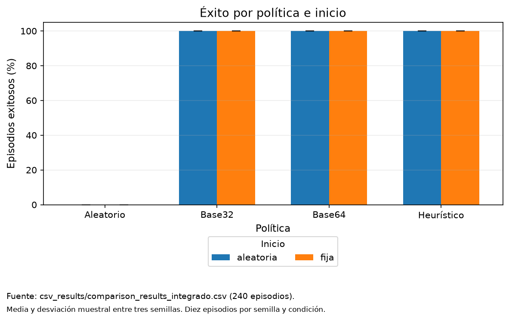
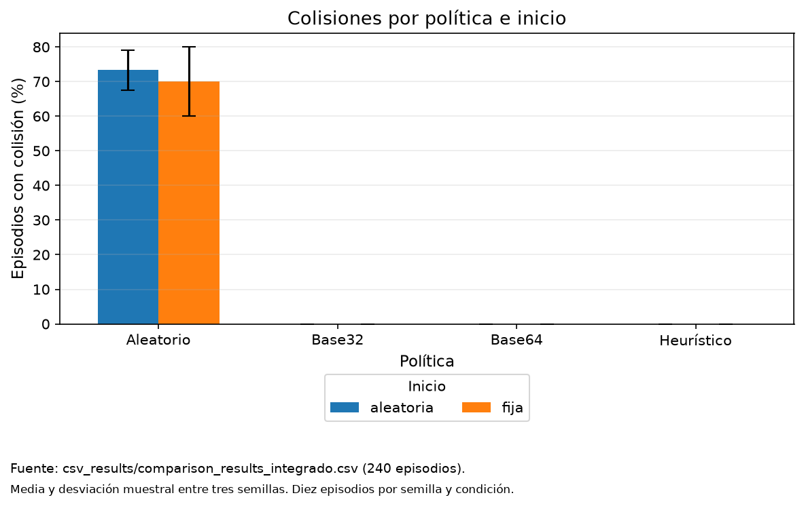
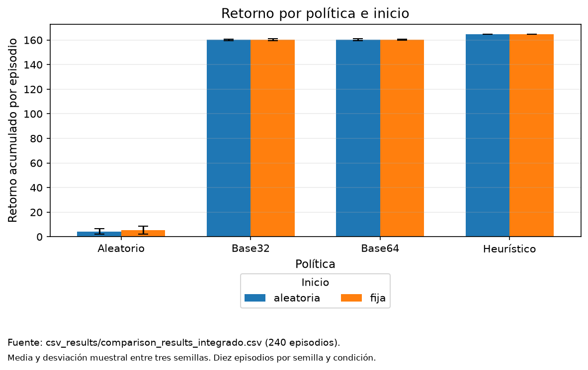
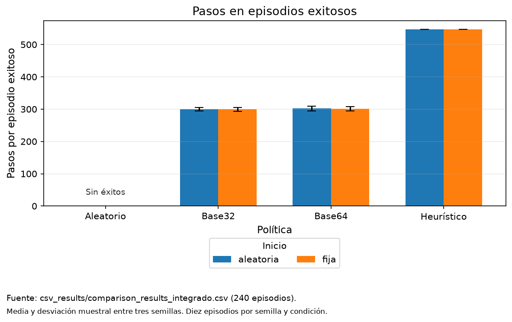
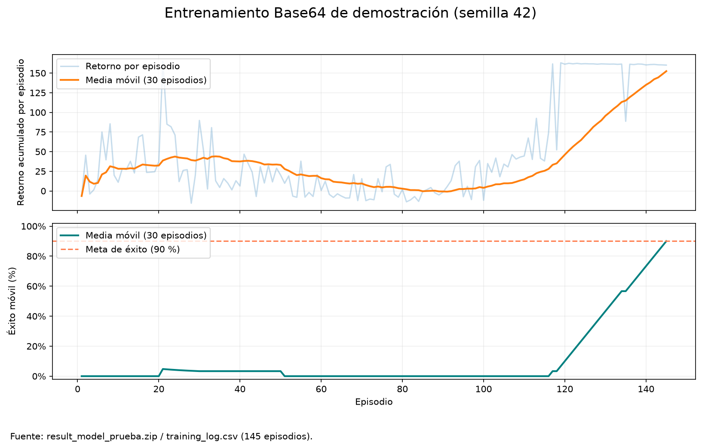

# Evidencia cuantitativa del proyecto Carrito Autónomo con DQN

Código de referencia `e566cdd9b3e57a734028cb0c7f119f3a48f43902`. Las
estadísticas del lote histórico y las de la demostración se presentan por
separado. La [bitácora](bitacora_proyecto.md) documenta el diseño, la
configuración y la procedencia.

## A. Evidencia histórica auditada

El conjunto integra **240 episodios con 240 claves únicas** formadas por
agente, configuración, condición, semilla y episodio. Incluye 120 episodios
DQN (Base32 y Base64) y 120 de referencia (aleatorio y heurístico). En cada
política hay diez episodios por combinación de semilla (42, 123, 999) e inicio
(fijo o aleatorio). Esto da 24 grupos por semilla y ocho agregados de 30
episodios. El archivo integrado coincide con las dos fuentes de episodios
dentro de una tolerancia absoluta y relativa de `1e-12`. La mayor diferencia numérica entre sus
representaciones fue `2.84e-14`. Se recalcularon los 24 grupos y ocho
agregados y se cotejaron las 4 filas DQN, 12 filas por semilla y 8 filas
comparativas del informe experimental suministrado, con el redondeo publicado.
[CSV integrado](../csv_results/comparison_results_integrado.csv),
[resumen por semilla](../csv_results/comparison_resumen_por_semilla.csv),
[resumen general](../csv_results/comparison_resumen_general.csv).

Por grupo, éxito y colisión son porcentajes sobre sus diez episodios.
El retorno es la suma de recompensas por episodio. Los pasos en éxito
promedian únicamente filas con `success=1`. Para cada política e inicio se
calcula la media de las tres estadísticas por semilla y la desviación
estándar muestral entre semillas (`ddof=1`). La desviación describe la
dispersión observada entre tres semillas. El campo de pasos exitosos queda
vacío cuando el grupo carece de éxitos. El
[CSV derivado del notebook](evidencias_cuantitativas/historico_por_semilla.csv)
incluye además la media de pasos de todos los episodios, con tasas expresadas
como proporciones de 0 a 1.

### Comparación por política y modalidad

Cada celda numérica resume media ± desviación estándar muestral entre semillas.

| Política | Inicio | Éxito (%) | Colisión (%) | Retorno | Pasos en éxito |
| --- | --- | --- | --- | --- | --- |
| Aleatorio | aleatoria | 0.00 ± 0.00 | 73.33 ± 5.77 | 4.240 ± 2.193 | Sin éxitos |
| Aleatorio | fija | 0.00 ± 0.00 | 70.00 ± 10.00 | 5.464 ± 3.329 | Sin éxitos |
| Base32 | aleatoria | 100.00 ± 0.00 | 0.00 ± 0.00 | 160.128 ± 0.666 | 299.33 ± 5.48 |
| Base32 | fija | 100.00 ± 0.00 | 0.00 ± 0.00 | 160.172 ± 0.792 | 299.33 ± 5.86 |
| Base64 | aleatoria | 100.00 ± 0.00 | 0.00 ± 0.00 | 160.258 ± 0.667 | 301.83 ± 7.38 |
| Base64 | fija | 100.00 ± 0.00 | 0.00 ± 0.00 | 160.180 ± 0.498 | 301.33 ± 7.02 |
| Heurístico | aleatoria | 100.00 ± 0.00 | 0.00 ± 0.00 | 164.588 ± 0.007 | 546.77 ± 0.06 |
| Heurístico | fija | 100.00 ± 0.00 | 0.00 ± 0.00 | 164.629 ± 0.000 | 547.00 ± 0.00 |

En los registros publicados, ambas arquitecturas DQN y el heurístico lograron
100 % de éxito y 0 % de colisión en los dos inicios. El heurístico obtuvo el
mayor retorno medio y empleó aproximadamente 547 pasos por episodio exitoso.
Base32 y Base64 necesitaron cerca de 299–302 pasos. El aleatorio no registró
éxitos y su tasa de colisión fue de 70.00 % en inicio fijo y 73.33 % en inicio
aleatorio. Las diferencias de retorno entre Base32 y Base64 son pequeñas
respecto de la dispersión entre semillas observada.

### Base32 y Base64 por semilla

Cada fila resume diez episodios. Los doce grupos tuvieron 10/10 éxitos y
0/10 colisiones.

| Arquitectura | Semilla | Inicio | Retorno medio | Pasos medios en éxito |
| --- | --- | --- | --- | --- |
| Base32 | 42 | aleatoria | 159.791 | 297.50 |
| Base32 | 123 | aleatoria | 160.895 | 305.50 |
| Base32 | 999 | aleatoria | 159.698 | 295.00 |
| Base32 | 42 | fija | 159.654 | 297.00 |
| Base32 | 123 | fija | 161.084 | 306.00 |
| Base32 | 999 | fija | 159.777 | 295.00 |
| Base64 | 42 | aleatoria | 159.502 | 294.10 |
| Base64 | 123 | aleatoria | 160.509 | 302.60 |
| Base64 | 999 | aleatoria | 160.763 | 308.80 |
| Base64 | 42 | fija | 159.611 | 294.00 |
| Base64 | 123 | fija | 160.398 | 302.00 |
| Base64 | 999 | fija | 160.532 | 308.00 |

### Figuras del lote auditado

Las cuatro figuras usan el CSV integrado y la agregación por semilla del
notebook experimental. Las barras de error representan una desviación
muestral. El agente aleatorio carece de barra en la gráfica de pasos exitosos.









Los seis checkpoints originales, uno por arquitectura y semilla, siguen
ausentes. Los CSV experimentales tampoco registran las huellas de esos
archivos ni la configuración efectiva completa. El lote se auditó
matemáticamente y su reejecución exacta sigue bloqueada.
[Trazabilidad](evaluacion/trazabilidad_checkpoints.md).

## B. Evidencia reproducida con el modelo Base64 real

La evaluación independiente usó `best_model.pt` del paquete
`result_model_prueba.zip`, SHA-256
`8fca3c72f147cd94af182417e55e4093ed0f6ff8eaf3448e654650d51c04f5b1`.
Se usó PyTorch 2.15.0+cpu, política greedy y semillas de evaluación 42 a 51 en
cada condición. Los diez episodios fijos y los diez aleatorios coincidieron
fila por fila con los CSV de referencia. En esta tabla la desviación
estándar del retorno es **poblacional** sobre los diez episodios de cada
condición (`ddof=0`). [Resumen derivado](evidencias_cuantitativas/base64_reproducido_resumen.csv),
[registro de verificación](evaluacion/evidencias/carga_centralizada_2026-11-24.txt).

| Inicio | Episodios | Éxito (%) | Colisión (%) | Retorno medio | DE poblacional | Pasos en éxito |
| --- | --- | --- | --- | --- | --- | --- |
| fija | 10 | 100 | 0 | 161.682435 | 0.000000 | 326.0 |
| aleatoria | 10 | 100 | 0 | 161.819313 | 0.080403 | 326.1 |

La comparación con el grupo histórico Base64/42 revela diferencias aun con
la misma etiqueta de arquitectura y semilla de entrenamiento. El checkpoint
exacto del grupo histórico, sus parámetros efectivos y su entorno de
ejecución no se pueden determinar a partir de los CSV. En el código revisado,
el inicio fijo conserva la posición y la orientación tangente, de modo que
cambiar solo la semilla de reinicio no explica la diferencia fija.
[Trazabilidad del Base64](evaluacion/trazabilidad_checkpoints.md).

| Inicio | Retorno histórico Base64/42 | Diferencia de retorno con el reproducido | Pasos históricos en éxito | Diferencia de pasos con el reproducido |
| --- | --- | --- | --- | --- |
| fija | 159.610807 | +2.071628 | 294.0 | +32.0 |
| aleatoria | 159.501845 | +2.317468 | 294.1 | +32.0 |

### Curvas del entrenamiento de demostración

El `training_log.csv` del ZIP contiene 145 episodios y suma 45 552 pasos.
El gráfico usa medias móviles de 30 episodios. La línea de éxito al final
refleja 27 éxitos de los últimos 30. La tabla usa dos ventanas distintas,
los primeros 50 episodios (1–50) y los últimos 50 (96–145). El éxito y la
colisión se expresan en porcentaje. Se publica el
[contraste derivado del notebook](evidencias_cuantitativas/entrenamiento_base64_contraste.csv)
con tasas en escala de 0 a 1.



| Métrica | Primeros 50 | Últimos 50 | Cambio |
| --- | --- | --- | --- |
| Retorno | 32.80 | 105.27 | +72.46 |
| Pasos por episodio | 470.10 | 302.92 | -167.18 |
| Éxito (%) | 2.00 | 54.00 | +52.00 |
| Colisión (%) | 94.00 | 46.00 | -48.00 |

## C. Compatibilidad técnica Base32

Un checkpoint sintético permitió cargar una red de 32 neuronas por capa,
ejecutar inferencia y verificar la exportación de ambos CSV y su manifiesto.
Esta prueba funcional carece de una fase de entrenamiento. La evidencia de
rendimiento de Base32 se limita a los registros históricos de la sección A.
[Pruebas de carga](../tests/test_checkpoint_load.py),
[validación sintética](evaluacion/evidencias/carga_centralizada_2026-11-24.txt).

## Inventario y huellas SHA-256

Los siguientes nueve CSV versionados conservaron el mismo SHA-256 que la
auditoría previa. Las dos exportaciones aleatorias de Base64 son copias
idénticas. El CSV visual de dos episodios coincide con las primeras dos
filas del fijo. Se conservan como comprobaciones documentadas y no se
cuentan como episodios adicionales.

La columna local corresponde a los bytes CRLF del worktree auditado. La
columna Git corresponde a los bytes LF de `e566cdd` y permite verificar
los CSV descargados desde GitHub.

| CSV original | Filas | Procedencia | SHA-256 local auditado | SHA-256 de Git (LF) |
| --- | --- | --- | --- | --- |
| [evaluation_results.csv](../csv_results/evaluation_results.csv) | 120 | Episodios DQN de la rama experimental | `ed6823c2e91a013151a690b4f661ad4142bf6f598eb74753178c66ac0e8f7270` | `3cbb44a46ef8e6052a47081d09aec182b2f87bc2337b866851ce08eb4d6ae5d4` |
| [comparison_results.csv](../csv_results/comparison_results.csv) | 120 | Episodios de los agentes de referencia | `57caf770b946125a3c50f63fadcb891e5558c36f33de9020c87003021834c97f` | `d99f8c52122ab8e0dca99e299f924ab77f04c279b030fca7064f473c1dc50233` |
| [comparison_results_integrado.csv](../csv_results/comparison_results_integrado.csv) | 240 | Unión del lote experimental y de referencia | `4c9397d8e2da609d60721697dab650c3001cd5c76798c28f866cfc3bbebadb42` | `23803fc9b827334ef6a1d23221df73d9a51c38a024d904d7208ddfd2ff239b09` |
| [comparison_resumen_por_semilla.csv](../csv_results/comparison_resumen_por_semilla.csv) | 24 | Agregados históricos por semilla | `96c9592caee857cae80c4eb97d81f7e0e8c91c6b264143775cee6146e4dc4de8` | `5c53af8a1c0cf98ef6c911c1ccfaa80ecda83d7474e87d014743bee78fbe52cd` |
| [comparison_resumen_general.csv](../csv_results/comparison_resumen_general.csv) | 8 | Agregados históricos entre semillas | `d8c71c89d3e552e1cb60f3550e47c58b5a543b3466df439b07785554e2676a2e` | `5b1b3801e752984d1f6ca62e41a443ffbf5319bea28eb06166e0ceeabb8ddcca` |
| [evaluacion_best_aleatoria_py311_20261123_01.csv](../results/evaluacion_best_aleatoria_py311_20261123_01.csv) | 10 | Base64 conocido, inicio aleatorio | `5f3ae68a99a01f347890781f4410921b90bf147283705e165da2c881410c02d9` | `4565d8945270cd22606d1fa78bbed23af69784b216aeee56c3c620f89cf71f40` |
| [evaluacion_best_aleatoria_py311_20261123_02.csv](../results/evaluacion_best_aleatoria_py311_20261123_02.csv) | 10 | Copia idéntica de la salida aleatoria | `5f3ae68a99a01f347890781f4410921b90bf147283705e165da2c881410c02d9` | `4565d8945270cd22606d1fa78bbed23af69784b216aeee56c3c620f89cf71f40` |
| [evaluacion_best_fija_py311_20261123_01.csv](../results/evaluacion_best_fija_py311_20261123_01.csv) | 10 | Base64 conocido, inicio fijo | `ee56c24ffb8a5d855bf08ab59b106cb515a40e26ad82f23470a44e9a7f0a9beb` | `7b2660c998cd17f5c1c690ae079a8a0eef81e89188e87f00dd2a83a753c52d18` |
| [evaluacion_best_visual_py311_20261123_01.csv](../results/evaluacion_best_visual_py311_20261123_01.csv) | 2 | Prueba visual Base64, coincidente con las primeras dos filas fijas | `15b2a86919cb8380c39481106d6bf5866d648d0fe9df3cf76c397f1c616fc9a8` | `a9cc0a963b1241b63d2ceb4685832843e3a31400af22e4337b6127777e159d72` |

Los siguientes insumos se distribuyen fuera del repositorio. Los archivos
del ZIP coinciden con los originales locales inspeccionados.

| Archivo | Procedencia | SHA-256 |
| --- | --- | --- |
| `best_model.pt` | Checkpoint de demostración reproducido | `8fca3c72f147cd94af182417e55e4093ed0f6ff8eaf3448e654650d51c04f5b1` |
| `final_model.pt` | Estado final de ese entrenamiento | `a6aae0e6395290c273f387026509381cc3632d7091ba45c9b3d5994108b3f8b2` |
| `training_log.csv` | Registro de 145 episodios | `2dd65a595cc5378e6fbad9007501ce5731656849f8cf92cb90303962ce187ab8` |
| `evaluation_summary.csv` | Resumen de una fila en el paquete original | `cff317873b1886b500836cca8b96c6625c5ad17342ece89a2a7a519b4df22bdd` |
| `training_curves.png` | Gráfica suministrada en el paquete original | `eb29d5f6c382e13cdd8bd720deaf7340d9dc230c9d3982f5b4b1c6dda2be7011` |
| `result_model_prueba.zip` | Paquete externo que reúne los cinco insumos | `b4a19da386a7cfd3f442a20d871b673c917c014956e8f846aefe8ee30fb5e3d0` |

### Archivos derivados incluidos

Las huellas de los CSV derivados se calculan con finales de línea LF.

| Archivo | Fuente o contenido | SHA-256 |
| --- | --- | --- |
| [historico_exito.png](evidencias_cuantitativas/historico_exito.png) | Tasas de éxito del lote integrado | `6ebeacd77a1b93d06e7bdb34a16abb7418a9733bdc7152ed50a068aaaccd6f5d` |
| [historico_colision.png](evidencias_cuantitativas/historico_colision.png) | Tasas de colisión del lote integrado | `bb151c3df59fc114b5d1d3b1765d403f5be925d479c0e55bb496cf866c0b0ad8` |
| [historico_retorno.png](evidencias_cuantitativas/historico_retorno.png) | Retorno acumulado del lote integrado | `96ec8f6becfcfe1750152e8ee35d12250cf386a284eb40947e59d8351c905d18` |
| [historico_pasos_exitosos.png](evidencias_cuantitativas/historico_pasos_exitosos.png) | Pasos en episodios exitosos del lote integrado | `1fa75b657ce16c3a8d4f5f87a5d0cb96d8398a71fb75330649e8d6c869998515` |
| [entrenamiento_base64_curvas.png](evidencias_cuantitativas/entrenamiento_base64_curvas.png) | Curvas del registro real de 145 episodios | `93c19150391a51f46d702fe7adb04a0a39f2a2f61593df23e6e24f5a2e10fffb` |
| [historico_por_semilla.csv](evidencias_cuantitativas/historico_por_semilla.csv) | 24 grupos del notebook experimental | `8feaae2b647ad131df70f27e5650f0e2c8208f9328305cd120da1c8dbbb38b43` |
| [entrenamiento_base64_contraste.csv](evidencias_cuantitativas/entrenamiento_base64_contraste.csv) | Ventanas de 50 episodios del notebook de entrenamiento | `10f6169b0695825b9167711d91c52bd4c0705e483ffbb3b60ebab1a21926efd8` |
| [base64_reproducido_resumen.csv](evidencias_cuantitativas/base64_reproducido_resumen.csv) | Agregados de los dos CSV Base64 reproducidos | `ca5764a98ec25d24fc2e593eafd474756c28f397864b2f63d7364fb14e883001` |

## Regeneración de figuras y tablas

Instala las dependencias opcionales y registra el kernel `carrito-dqn` con
las instrucciones del [README](../README.md#ejecutar-los-notebooks).
El generador usa estos insumos:

| Insumo | Disponibilidad |
| --- | --- |
| `analisis_experimental.ipynb`, `analisis_entrenamiento.ipynb` y `comparison_results_integrado.csv` | Versionados. Proporcionan el flujo de análisis y los 240 registros del lote histórico. |
| `evaluacion_best_fija_py311_20261123_01.csv` y `evaluacion_best_aleatoria_py311_20261123_01.csv` | Versionados. Proporcionan las 20 filas del Base64 para el resumen derivado. |
| `training_log.csv` de 145 episodios | Único insumo de datos externo para regenerar el paquete. Solicita al equipo el archivo `result_model_prueba.zip` de la entrega, extrae el registro y comprueba el SHA-256 de la tabla anterior. |

Una clonación limpia necesita ese registro externo para ejecutar el generador
completo. Por ahora el ZIP se obtiene de los materiales de entrega del equipo.
GitHub Releases es el canal previsto después de integrar `main`. Para
regenerar las figuras y tablas basta el registro. El checkpoint `best_model.pt`
se requiere para repetir la demostración en el simulador. Consulta el bloque
[Demostración Base64](../README.md#demostración-base64-con-el-paquete-de-entrega)
para extraer el ZIP con seguridad y verificar sus archivos. Ejecuta desde la
raíz con el intérprete del entorno de notebooks.

```powershell
$Registro = (Resolve-Path "results_demo_base64/training_log.csv").Path
$Destino = Join-Path ([System.IO.Path]::GetTempPath()) ("carrito-evidencia-" + [guid]::NewGuid().ToString("N"))
& $ProyectoPython -X utf8 -B docs/evidencias_cuantitativas/generar.py --training-log $Registro --output $Destino
```

El [generador](evidencias_cuantitativas/generar.py) ejecuta copias en memoria
de los [notebooks experimental](../notebooks/analisis_experimental.ipynb) y
[de entrenamiento](../notebooks/analisis_entrenamiento.ipynb). Sustituye su
celda de exportación en memoria para añadir títulos, unidades y fuentes.
Produce los derivados en un directorio nuevo y exige la huella exacta del
registro Base64. Las tablas de esta página se obtienen de los CSV originales
o de las exportaciones indicadas. La generación documentada se realizó con
Python 3.11.9, pandas 2.3.3, Matplotlib 3.11.2 y nbclient 0.11.0.
